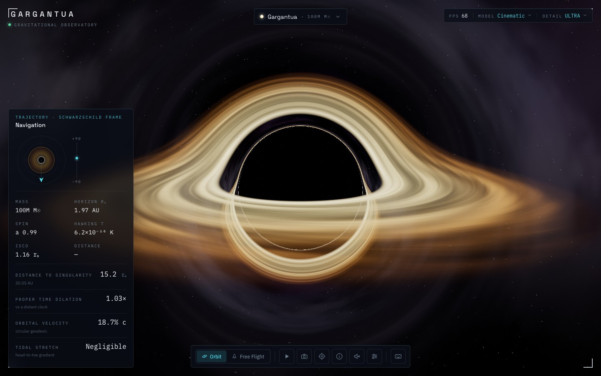

# GARGANTUA

**A real-time, physically-grounded black hole observatory & explorer — an interactive homage to _Interstellar_'s Gargantua, built with the actual physics of bending light.**



Gargantua renders black holes the way the film's team did: not with a texture, but by tracing each photon's curved path through Schwarzschild spacetime. Light from the far side of the accretion disk bends up and over — and down and under — the shadow, wrapping the flat disk into the iconic halo. Fly around it, switch between real black holes, label the anatomy, read a built-in encyclopedia, and watch the relativistic telemetry rescale for each object.

Live gravitational lensing · cinematic post-processing · a deep-space observatory interface · a black-hole codex.

---

## Features

- **Real gravitational lensing.** A GLSL fragment shader integrates photon geodesics per pixel (`a = −1.5·h²·p / r⁵`), calibrated so the photon sphere sits at 1.5 rₛ and the shadow at ≈2.6 rₛ — the disk genuinely wraps the sky, with higher-order photon rings.
- **A multi-object explorer.** Switch the live render between Gargantua and real black holes — each with accurate mass, spin, and distance, distinct disk physics, and its own encyclopedia entry (see below).
- **Two looks.** _Cinematic_ (warm, near-symmetric — Doppler beaming suppressed, as Nolan & Thorne chose) and _Scientific_ (relativistic beaming brightens the approaching edge). Disk colour follows temperature — Gargantua glows gold, Cygnus X-1 blazes blue-white.
- **The Codex.** A browsable, searchable encyclopedia — ~40 layered articles (accessible prose + optional "go deeper" technical detail and equations) spanning anatomy, relativity, Hawking radiation, mergers, black-hole types, real objects, and the Interstellar science.
- **Interactive anatomy overlay.** Toggle labelled callouts that track the live black hole (event horizon, photon ring, disk, ISCO, ergosphere, jet) and link straight into the Codex.
- **Object-aware telemetry.** Distance in Schwarzschild radii, gravitational time dilation, orbital & escape velocity, plus per-object vitals — Schwarzschild radius in km, Hawking temperature, ISCO, and a tidal-force verdict that turns lethal for stellar-mass holes and gentle for giants. Every readout is explained on hover.
- **Explore freely.** Orbit mode (drag + dolly), pointer-lock free flight (WASD + mouse-look), viewpoint presets, and a keyboard shortcut for everything.
- **A guided grand tour** — 11 narrated chapters that fly you through the anatomy and across every object, with play/pause/skip transport.
- **Relativistic jets, cinematic post-FX** (subtle grain / vignette / chromatic aberration, toggleable), a synthesized **ambient drone** (no copyrighted audio), and a clean/cinematic hide-UI view.
- **Adaptive performance.** Quality tiers scale ray-step count _and_ render resolution to keep it smooth, desktop-first, with graceful mobile fallback.

## Explore real black holes

| Object | Mass | Character |
| --- | --- | --- |
| **Gargantua** | 100 M M☉ | _Interstellar_'s fictional black hole — near-maximal spin, cool gold disk, fierce time dilation |
| **Sagittarius A\*** | 4.3 M M☉ | The Milky Way's own; imaged by the EHT in 2022 |
| **M87\*** | 6.5 B M☉ | First black hole ever imaged (2019); drives a 5,000-ly relativistic jet |
| **Cygnus X-1** | 21 M☉ | A stellar-mass furnace — blazing blue-white disk, lethal tides |
| **TON 618** | ~40 B M☉ | An ultramassive quasar, one of the largest known |

## The physics

Each pixel casts a ray from the observer and marches it through curved spacetime with adaptive step size — coasting far away, refining near the hole and the disk plane. Working in units where the Schwarzschild radius `rₛ = 1`:

| Quantity | Value | In the sim |
| --- | --- | --- |
| Event horizon | 1 rₛ | ray capture → black |
| Photon sphere | 1.5 rₛ | trapped light → photon ring |
| Apparent shadow | ≈ 2.6 rₛ | critical impact parameter |
| ISCO (disk inner edge) | 3 rₛ (a=0) → 0.5 rₛ (a→1) | Kerr, from spin |

The accretion disk is sampled at each equatorial-plane crossing and composited front-to-back, so a single ray picks up the near face _and_ the lensed far side over the top and under the bottom. Physical scale is derived from each object's mass: Schwarzschild radius `r_s = 2GM/c²`, Hawking temperature `T_H = ℏc³/8πGMk_B`, time dilation `1/√(1−rₛ/r)`, and a tidal term `∝ 1/M²`. The approach follows Thorne et al., [_Gravitational Lensing by Spinning Black Holes…and in the Movie Interstellar_](https://arxiv.org/abs/1503.08305).

> **Scope note:** the renderer uses exact Schwarzschild geodesics for real-time performance. "Spin" scales the disk's inner radius and Doppler intensity and is reported in the vitals, but the light-bending metric is Schwarzschild, not full Kerr with frame-dragging. Jets are a stylised volumetric effect.

## Controls

| Navigate | | Explore | | Interface | |
| --- | --- | --- | --- | --- | --- |
| Drag | Orbit | `1`–`5` | Switch black hole | `K` | Codex |
| Scroll | Zoom | `T` | Tour play / pause | `H` | Hide interface |
| `W A S D` | Fly | `←` `→` | Tour chapter | `F` | Fullscreen |
| `Space`/`Ctrl` | Fly up / down | `C` | Cinematic / Scientific | `?` | Shortcuts |
| `Shift` | Boost | `A` | Anatomy labels | `Esc` | Close panels |
| `R` | Reset view | `V` | Vantage points | | |

Free flight uses pointer lock — click to capture the mouse, `Esc` to release.

## Tech stack

Vue 3 (`<script setup>`) · TypeScript · Vite · Three.js (WebGL harness + `UnrealBloomPass` → `OutputPass` HDR bloom → post-FX `ShaderPass`, ACES tone mapping) · Tailwind CSS v4 (CSS-first `@theme`). No state-management or UI-kit dependencies — a single reactive parameter store drives the shader uniforms and every panel.

## Getting started

```bash
pnpm install
pnpm dev        # http://localhost:5173
pnpm build      # type-check + production bundle to dist/
pnpm preview    # serve the production build
```

Requires a WebGL2-capable browser with hardware acceleration. Node 20+.

## Deploy

The app is a static single-page app — deploy `dist/` anywhere. It has no client routing; any non-home path redirects to `/`.

- **Vercel:** zero-config. The included `vercel.json` sets the Vite framework preset and an SPA fallback (every path serves the app); push the repo and import it, or run `vercel`.
- **GitHub Pages:** automated via `.github/workflows/deploy.yml` — every push to `main` builds with `DEPLOY_TARGET=gh-pages` (base `/gargantua/`) and deploys. Live at **https://engelde.github.io/gargantua/**. To build the Pages bundle locally:
  ```bash
  DEPLOY_TARGET=gh-pages pnpm build
  ```
  (`vite.config.ts` switches `base` to `/gargantua/` when `DEPLOY_TARGET=gh-pages`, and emits a `404.html` SPA fallback since Pages has no server rewrites.)

## Project structure

```
src/
  shaders/       blackhole.frag.glsl (geodesic ray-marcher) · postfx.frag.glsl
  composables/   renderer, camera controls, director, objects, params store,
                 audio, perf, keyboard shortcuts, observatory context
  components/    viewport, anatomy overlay, telemetry HUD, object selector,
                 control deck, Codex, tour + shortcuts overlays, panels, ui/*
  data/          black holes · codex (~40 articles) · glossary · presets · tour
  utils/         relativity math + easing
```

## Credits

Inspired by the visualization of Gargantua in Christopher Nolan's _Interstellar_ (2014) and the science of Kip Thorne. Facts drawn from NASA, ESO, the Event Horizon Telescope, and LIGO. This is an independent educational project and is not affiliated with or endorsed by the film or its rights holders.

## License

MIT
